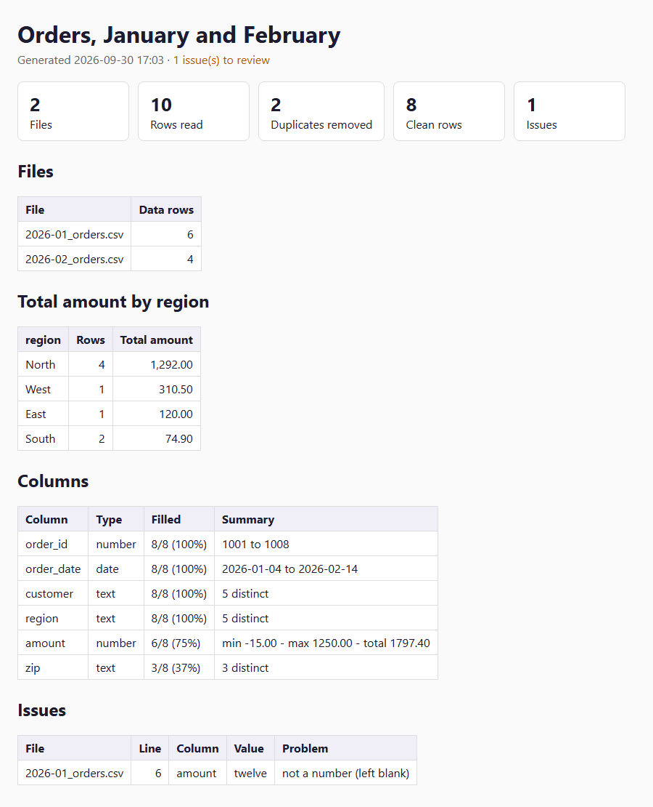

# Python automation examples

**Three small, tested Python tools for jobs that eat hours every week: cleaning spreadsheet exports, keeping two systems in sync, and shipping releases without mistakes.**

Standard library only (Python 3.10+): nothing to install, runs on Windows, macOS and Linux. 43 tests run on every push. All data in this repository is made up.

| Tool | The job | What makes it safe to rely on |
|---|---|---|
| [`csv_report`](#1-csv-cleanup-and-report) | Merge messy CSV exports into one clean table, an Excel file and an HTML report | Flags values it can't read instead of guessing; keeps leading zeros; newer exports override older ones |
| [`api_sync`](#2-rest-api-sync-with-retries-and-a-read-back-check) | Push a price list from a CSV into a REST API | Dry run by default; retries with backoff; reads every write back to prove it stuck |
| [`release_packager`](#3-release-packager-with-sha-256) | Build a release zip with checksums | Dry run by default; never overwrites a release; blocks secrets; byte-identical rebuilds |

## 1. CSV cleanup and report



```
$ python csv_report/csv_report.py "csv_report/sample_data/*.csv" --key order_id --group-by region --sum amount
read 10 row(s) from 2 file(s); 2 duplicate(s) removed; 8 clean row(s)
column types: order_id=number, order_date=date, customer=text, region=text, amount=number, zip=text
issue  2026-01_orders.csv:6  amount  'twelve'  not a number (left blank)
wrote report_out/clean.csv, clean.xlsx, report.html
```

The two sample files are messy the way real exports are: one is UTF-8 with commas, the other Windows-1252 with semicolons and decimal commas; headers differ (`Order ID` vs `order-id`); dates come in three formats; amounts look like `"$1,250.00"`, `(20.00)` and `N/A`; one order appears in both months.

- **Reads what people actually send:** detects the delimiter and encoding, normalizes headers so different column names and orders merge, understands `$1,234.50`, `(5.00)`, `-$15.00`, `120,50` and `1.250,00`.
- **Never guesses silently.** A column is treated as numbers or dates when at least 80% of it parses; every value that doesn't is listed with its file and line.
- **Keeps what matters:** `04011` stays `04011` (ZIP codes, IDs). With `--key`, a later file's row replaces an earlier one, so the newest export wins.
- **Three outputs:** `clean.csv`, `clean.xlsx` (real numbers and dates, bold header, filter, frozen top row) and `report.html` (the screenshot above). `--strict` returns exit code 1 when anything needs review, for use in scheduled jobs.

## 2. REST API sync with retries and a read-back check

```
$ python api_sync/api_sync.py --base-url http://127.0.0.1:8765 --source api_sync/sample_prices.csv
plan: 1 to create, 2 to update, 1 unchanged, 1 only in the API (left alone)
  + D-400  Laptop sleeve 14 in  price 19.00  stock 25
  ~ A-100  price: '24.99' -> '22.99'
  ~ B-200  stock: 80 -> 64
  = C-300  only in the API, not touched
dry run: nothing was written. Run again with --apply to make 3 change(s).

$ python api_sync/api_sync.py --base-url http://127.0.0.1:8765 --source api_sync/sample_prices.csv --apply
...
applied: 3 written and verified, 0 failed, 0 read-back mismatch(es)
```

- **Checks the whole source first.** One bad row (empty SKU, a price like `abc`, stock `1.5`, a duplicate) stops the run before anything is sent, with every problem listed.
- **Shows the exact changes** field by field, and never deletes anything that is only in the API.
- **Survives a shaky connection:** network errors, timeouts and HTTP 429/5xx are retried with exponential backoff and jitter, and `Retry-After` is respected. Retrying is safe because every write is an idempotent `PUT`.
- **Proves the result.** After writing, it reads every item back. An API that answers "200 OK" but doesn't store the change is reported as a mismatch (exit code 1), not counted as done.
- **Keeps the token out of sight:** read from an environment variable, sent only in the `Authorization` header, never printed or written to the `--report` JSON.

Try it locally with the included demo API:

```
python api_sync/fake_api.py --port 8765                       # terminal 1
export SYNC_API_TOKEN=local-demo                               # terminal 2 (PowerShell: $env:SYNC_API_TOKEN="local-demo")
python api_sync/api_sync.py --base-url http://127.0.0.1:8765 --source api_sync/sample_prices.csv
```

## 3. Release packager with SHA-256

```
$ python release_packager/package_release.py release_packager/sample_app --name sample-app --version 1.4.0 \
      --changelog release_packager/sample_app/CHANGELOG.md --go
ok     version 1.4.0 is MAJOR.MINOR.PATCH
ok     version is new (no earlier release before it)
ok     no secret-looking files among 4 file(s)
ok     CHANGELOG.md mentions 1.4.0
files  4 file(s), 229 B before compression:
         sample-app/CHANGELOG.md  (101 B)
         ...
ok     verified 4 file(s) inside the zip against the source
built  dist/sample-app-1.4.0.zip  730 B  sha256 c44241c0...

$ python release_packager/package_release.py release_packager/sample_app --name sample-app --version 1.3.9
STOP   version 1.3.9 is not higher than the latest release in dist (1.4.0)
```

- **Dry run by default.** Nothing is written until you add `--go`.
- **Stops at the first failed check** and says what to fix: version format, version not newer than the last release, the release already exists, a changelog without the version, or a file that looks like a secret (`.env`, private keys, `*.pem`, cloud keys inside a text file).
- **Reproducible:** sorted entries and fixed timestamps, so the same input gives a byte-identical zip and the same SHA-256.
- **Verified before it counts:** the zip is written under a temporary name, reopened, checked file by file against the source, and only then renamed. Writes `.sha256` (works with `sha256sum -c`) and a JSON manifest of every file.

## Run the tests

```
python -m unittest discover -s tests -v
```

The API tests start the demo API on `127.0.0.1` on a free port and never wait for real backoff delays. Every safety feature above has a test, and each test was checked to fail when the feature is removed.

## Layout

```
csv_report/        csv_report.py + sample_data/
api_sync/          api_sync.py, fake_api.py (demo/test server), sample_prices.csv
release_packager/  package_release.py + sample_app/
tests/             one test file per tool
```

## License

MIT. See [LICENSE](LICENSE).

Made by **Off the Clock Software**. We build tools like these to order, fitted to your files, your API and your release process: [offtheclocksoftware.com](https://offtheclocksoftware.com).
